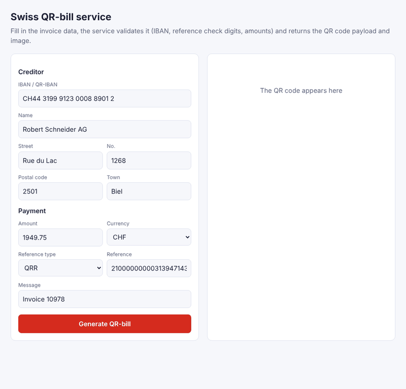
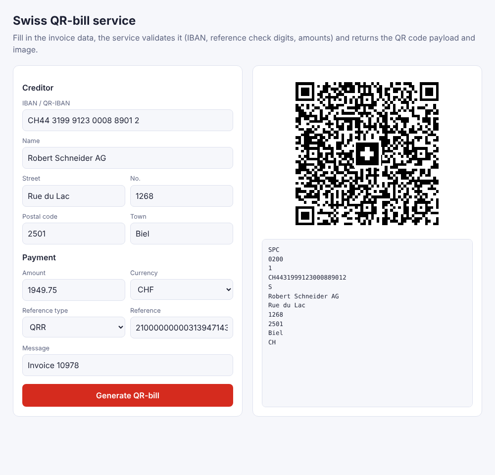
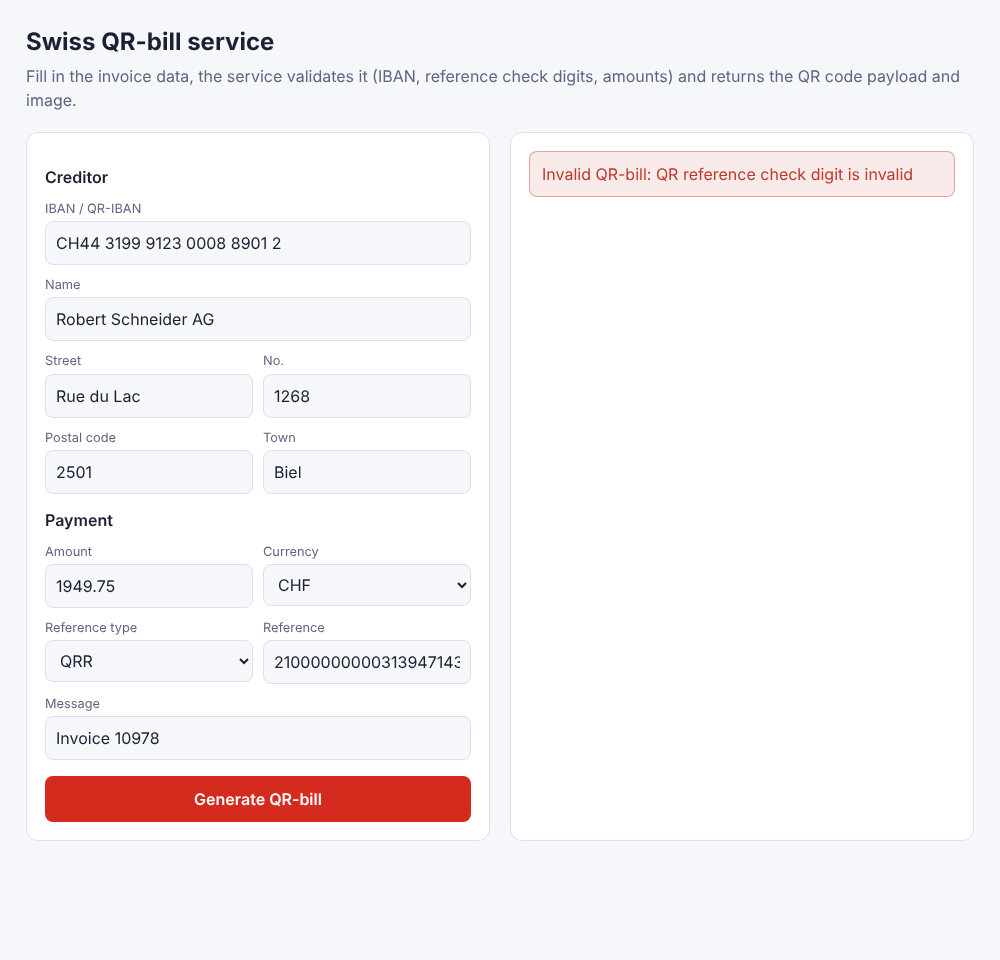
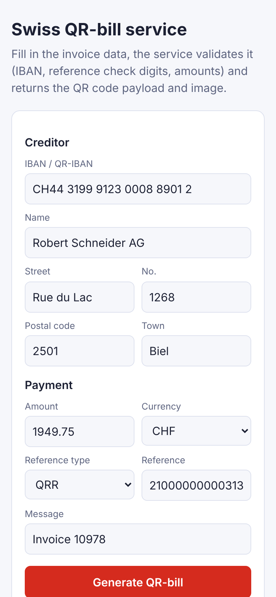
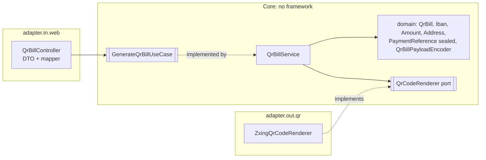

# Swiss QR-bill service

[](https://github.com/Vaggelisvl/swiss-qr-bill-service/actions/workflows/ci.yml)

A small Spring Boot 3 / Java 21 service that validates the data of a Swiss QR-bill and produces the QR code payload and image. Built as a showcase of clean, testable Java: hexagonal architecture, self-validating value objects, sealed types and an architecture that the build enforces.



| Result | Validation error | Mobile |
|---|---|---|
|  |  |  |

A small demo UI is served at `/` when the app is running.

## What it does
- Validates **IBAN / QR-IBAN** (CH, LI, ISO 7064 mod 97), **QR reference** (27 digits, mod 10 recursive), **creditor reference** (ISO 11649), amount, currency and addresses.
- Encodes the 32-line payload of the Swiss QR code (`SPC`, version `0200`).
- Renders the QR code as PNG (46 mm @ 300 dpi, error correction M, Swiss cross).
- Reports business errors as RFC 9457 problem details (HTTP 422).

## Architecture

Dependencies only point inwards; `ArchitectureTest` (ArchUnit) fails the build otherwise. Decisions are recorded in [`docs/adr`](docs/adr).

## Design highlights
- **Illegal states are unrepresentable:** each value object validates in its compact constructor ([ADR 0002](docs/adr/0002-make-illegal-states-unrepresentable.md)).
- **Sealed `PaymentReference`** (`QrReference`, `CreditorReference`, `NoReference`) with exhaustive `switch` in the mapper.
- **Pure domain encoder:** `QrBillPayloadEncoder` is a side-effect free function, trivially unit-testable.
- **Round-trip test:** the rendered PNG is decoded with ZXing and compared with the payload, proving the Swiss cross does not break scanning.
- **Quality gates in `mvn verify`:** `-Xlint:all -Werror`, Maven Enforcer (Java/Maven versions, dependency convergence), JaCoCo line coverage >= 85 %.
- **Operational basics:** graceful shutdown, health probes (`/actuator/health/liveness|readiness`), non-root multi-stage Docker image with layered jar, CI on GitHub Actions.

## Run
```bash
mvn verify            # tests, architecture rules, coverage gate
mvn spring-boot:run   # http://localhost:8080
# or
docker build -t swiss-qr-bill-service . && docker run -p 8080:8080 swiss-qr-bill-service
```

## API
```bash
curl -s localhost:8080/api/v1/qr-bills -H 'Content-Type: application/json' -d '{
  "creditorIban": "CH44 3199 9123 0008 8901 2",
  "creditor": {"name": "Robert Schneider AG", "street": "Rue du Lac", "buildingNumber": "1268",
               "postalCode": "2501", "town": "Biel", "country": "CH"},
  "amount": 1949.75,
  "currency": "CHF",
  "reference": {"type": "QRR", "value": "210000000003139471430009017"},
  "additionalInformation": "Invoice 10978"
}'
```
Returns `{"payload": "SPC\n0200\n...", "qrCodePngBase64": "..."}`. `POST /api/v1/qr-bills/image` returns the PNG directly. An invalid reference check digit yields:
```json
{"title": "Invalid QR-bill", "status": 422, "detail": "QR reference check digit is invalid"}
```

## Limitations
Structured addresses only, no alternative procedures or full payment-part layout, and the output is not SIX-certified (see [ADR 0003](docs/adr/0003-specification-scope.md)).

## License
MIT
